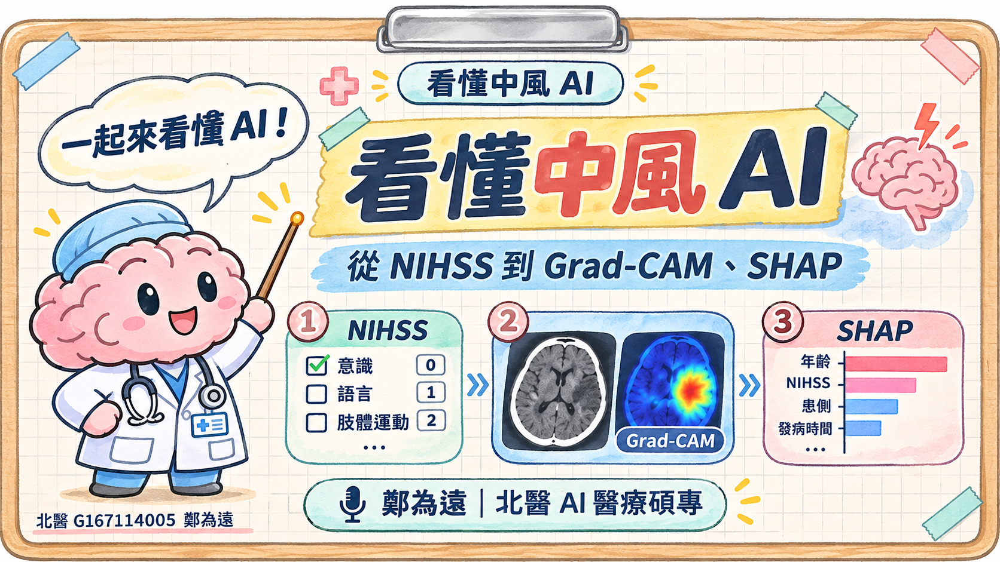
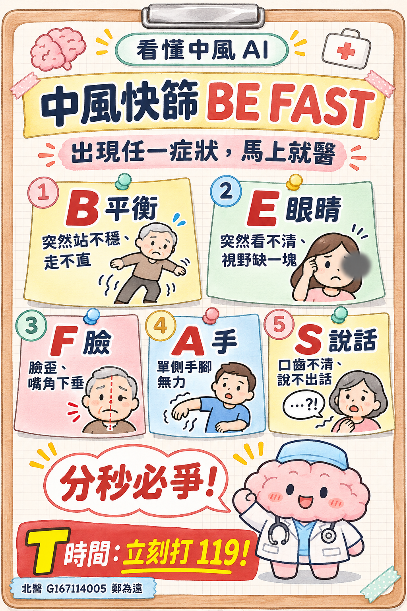
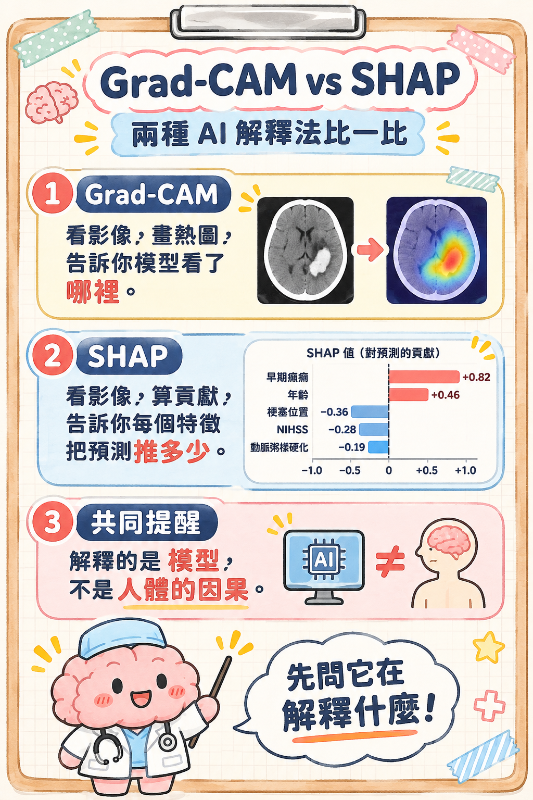

# 第 12 週作業：統一風格圖像產生的 Agent

北醫 G167114005 醫學院人工智慧醫療碩士在職專班 碩二 鄭為遠
系列：**看懂中風 AI 教學圖卡**；風格：**病歷夾手繪衛教風**；吉祥物：**腦腦醫師 Dr. NAO**
作品頁：https://g167114005.github.io/style-card-agent/

## 正式繳交版：ChatGPT 專案（3 種用途、3 種版型）
依作業要求，在 ChatGPT 建立專案「看懂中風 AI 統一風格圖像 Agent」：把風格規則寫進**專案指示**（`style/PROJECT_INSTRUCTIONS.md`，第 1 版留在 `_v1`），並把角色設定圖 `mascot.png` 上傳到**專案來源**。每次只要給「用途＋文字」，指令全文見 `prompts/project_prompts.md`。

| 投影片封面（16:9） | 衛教海報（2:3） | 學習圖卡（2:3） |
|---|---|---|
|  |  |  |

**風格跑掉與修正**（修正前的版本保留為 `*_drift.png`，過程截圖在 `screenshots/project/`）：
1. **封面第一次跑掉**：背景變成深藍科技風，吉祥物多了眼鏡。→ 修改專案指示（v2）：
   - 加上「最高優先：背景」：任何尺寸都用米白方格紙＋病歷夾，禁止深色或科技感背景。
   - 加上「生圖前自我檢查」4 項。
   - 角色描述明寫「不戴眼鏡」。
   - 改完後在同一對話要求重畫，就回到正確風格。
2. **海報第一次跑掉**：沒有用腦腦醫師，改成一位護理師，畫風也不同。→ 只靠專案來源裡的參考圖不夠，改成在對話中**直接附上 mascot.png** 再要求照專案指示重畫，就修正了。
3. **學習圖卡**：一開新對話就先附 mascot.png，第一次就符合風格。圖中 SHAP 長條圖的數值是模型自行畫的示意，不是真實資料。

**哪裡看得出風格一致**：
- 三件都是米白方格紙＋淺木色病歷夾。
- 都用同一組粉彩色票和深藏青文字。
- 都有紙膠帶標題、圓角便利貼和編號徽章。
- 都由同一隻腦腦醫師配對話框。

## 先導版（一般對話＋prompt 腳本）
專案版之前，先在一般對話中用 `tools/gen_card.py` 組好的完整 prompt 做了 4 張（角色設定圖＋3 張同尺寸圖卡）。這一版保留如下。

### 先導版作品（同一風格，共 4 張）
| 角色設定圖 | ① NIHSS | ② Grad-CAM | ③ SHAP |
|---|---|---|---|
|  |  |  |  |

每張圖卡上的文字和 `html/` 裡同名的 HTML 逐字相同，可直接打開 HTML 核對；更完整的內容與出處在 `notes/`。

### 先導版製作流程
```
notes/*.md ─skill: notes-to-html─▶ html/*.html ─gen_card.py─▶ prompts/*.txt ─GPT 影像生成─▶ output/*.png
 內容筆記                           一頁式網頁（只有內容）       風格合約＋版型＋逐字文字      一頁式教學圖卡
                                                                  （skill: html-to-png 涵蓋後兩步）
```
1. **定風格**（一次）：把色票、版型、筆觸、吉祥物和禁止事項寫成 `style/STYLE.md`。第 7 節是給模型的英文風格描述，每次生圖都原文貼上。
2. **notes → html**（skill `skills/notes-to-html`）：把內容筆記濃縮成固定版型的 HTML，包括標題、副標、①②③ 三塊、對話框、頁腳，每格都有字數上限。文字只在這一步決定。
3. **組 prompt**：`tools/gen_card.py` 解析 HTML，把「風格合約＋版型＋逐字文字」組成 prompt，存在 `prompts/`。
4. **生圖（本次實際做法：ChatGPT 桌面 App）**：agent 在同一個 ChatGPT 對話裡依序貼上 4 段 prompt。
   - 第 1 段畫角色設定圖。
   - 第 2–4 段畫圖卡，開頭都要求「沿用本對話上面那張角色設定圖」，靠對話上下文維持角色一致，不必再重新附圖。
   - 過程截圖在 `screenshots/`。
5. **QC**：驗收項目如下，結果見 `logs/qc.md`。
   - **角色設定圖**：有正面、側面、背面和三種表情；標題「腦腦醫師 Dr. NAO」正確；有色票。
   - **三張圖卡**：文字和 HTML 逐字相同；版型一致；吉祥物一致；色票一致。
     - 版型＝頂部膠囊、膠帶標題橫幅、①②③ 三塊便利貼、右下吉祥物加對話框、頁腳。
     - 吉祥物＝粉紅大腦、淺藍手術帽、銀色聽診器、白袍。
   - 本次每個檔案都只生成 1 次，第 1 次就全部符合驗收項目，沒有重跑。這就是「一次通過」的意思。

#### 設計目的：為什麼這樣「預期」能統一風格
- **風格與內容分離**：風格只寫在 STYLE.md，內容只寫在 HTML，每次生圖都用同一份描述，不靠臨場形容。
- **同一張角色設定圖當參考**：目的是讓吉祥物在每張圖卡長得一樣。
- **固定版型與字數上限**：目的是讓版面一致，並減少中文錯字。

以上是設計目的，不是保證。本次只生成一輪，依上面的驗收項目判定：3 張圖卡文字全對，角色和版型一致。我們沒有做不同字數或有無參考圖的對照實驗，所以不能據此宣稱哪一項設計有效。

### 先導版怎麼重現
**ChatGPT App 版（本次做法）**：開一個新對話，依序貼上下列 prompt，並把生成的圖片存成右欄的檔名：

| 順序 | 貼上的 prompt | 圖片存成 |
|---|---|---|
| 1 | `prompts/00_mascot.txt` | `style/ref/mascot.png` |
| 2 | `prompts/01_NIHSS.txt` | `output/01_NIHSS.png` |
| 3 | `prompts/02_GradCAM.txt` | `output/02_GradCAM.png` |
| 4 | `prompts/03_SHAP.txt` | `output/03_SHAP.png` |

**API 版（程式已寫好，本次沒有執行）**：用 Windows 的 PowerShell 開啟本資料夾，依序執行下面兩行。第一行只在目前視窗設定金鑰；也可以改在本資料夾建立 `.env`，內容寫 `OPENAI_API_KEY=sk-...`，這個檔案已列入 gitignore。
```powershell
$env:OPENAI_API_KEY = "sk-..."
.\run_all.bat
```
只看 prompt、不呼叫 API：
```powershell
python tools/gen_card.py html/01_NIHSS.html --dry-run
```
注意事項：
- **模型**：`gpt-image-1` 已於 2026-10-23 停用（見 [OpenAI 停用公告](https://developers.openai.com/api/docs/deprecations)）。請先用環境變數 `IMAGE_MODEL` 指定目前支援的影像模型，例如 `$env:IMAGE_MODEL = "gpt-image-2.5-flare"`。程式預設也已改成這個模型，但還沒實際呼叫測試過。
- **重跑**：輸出檔已存在時，舊檔會依序改名為 `_v1`、`_v2`…，不會被覆蓋。要修正錯字，可加 `--fix "第②塊的『xx』應為『yy』"`。
- **角色參考圖**：API 版畫圖卡時呼叫 `/v1/images/edits`，以 multipart 欄位 `image[]` 上傳 `style/ref/mascot.png`；畫角色設定圖本身則呼叫 `/v1/images/generations`，不附參考圖。
- **失敗時**：API 回傳錯誤時，程式會印出錯誤碼與訊息後，以結束碼 1 結束，不寫 log、不存圖，舊檔也不會被改名。`run_all.bat` 每一步都檢查結束碼，遇到第一個錯誤就停止，後面的圖不會繼續跑。
- **驗證程度**：上述行為已用模擬的 API 回應測試過，包括請求格式、存檔、舊檔改名和 log。還沒有對真實 API 執行過。
- 只用 Python 標準函式庫，不需要另外安裝套件。

## 檔案
```
AGENTS.md                 agent 規則
style/STYLE.md            風格合約；style/ref/mascot.png 角色設定圖
skills/notes-to-html/     skill 1
skills/html-to-png/       skill 2
tools/gen_card.py         組 prompt／呼叫 OpenAI API 的程式
notes/ html/ output/      三個階段的產物
prompts/                  實際送給 GPT 的完整 prompt
screenshots/              呼叫 GPT 生圖的過程截圖
logs/                     QC 紀錄（API 版另有每次呼叫的 JSON）
```

## 內容出處
- Grad-CAM、SHAP：Cheng W-Y, Lin H-Y, Tsai Y-J, Ko C-H. Explainable AI for Acute Ischemic Stroke Neuroimaging: A Critical Review of SHAP and Grad-CAM Applications and Their Methodological Limitations. *Diagnostics* 2026;16(22):3833. doi:10.3390/diagnostics16223833。各句對應的章節標在 `notes/02_GradCAM.md`、`notes/03_SHAP.md`。
- 白話解釋改寫自作者第 10 週作業的 wiki：https://g167114005.github.io/xai-stroke-llm-wiki/wiki-site/index.html （`concepts/grad-cam`、`concepts/shap`、`concepts/stroke-terms`）。
- NIHSS：NINDS NIH Stroke Scale，有 11 個主要評估項目，部分項目含子項或分左右側評分，總分 0–42（[Radiopaedia: NIHSS](https://radiopaedia.org/articles/nihss)）。圖卡為了字數只寫「11 項」。
